<div align="center">

# CS Demo Dashboard

**Turn a Counter-Strike demo file into a complete, visual performance report.**

Upload a `.dem`, sign in with Steam, and get a deep analysis of your own game: impact per round, duels, utility, timing, weapons, and a kill/death map on the radar.


<!-- TODO: add the CI badge once the workflow exists

-->

<!-- TODO: replace with a short demo GIF or video (see "Adding videos" at the end of the answer) -->
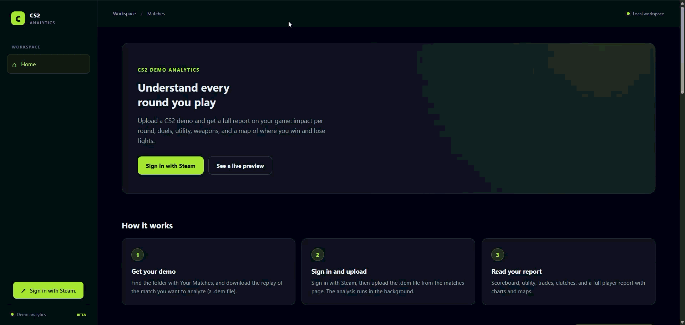
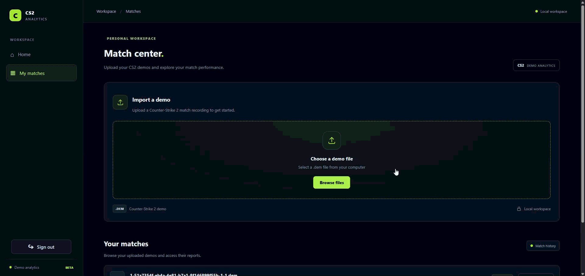

[Screenshots](#screenshots) · [Getting started](#getting-started)

</div>

---

## Why this project

I play a lot of Counter-Strike, and the in-game scoreboard says very little about *how* a match was played. Existing tools are either paywalled or built for pro teams. I wanted a free dashboard that answers practical questions about my own games:

- Did I win my opening duels?
- Were my deaths traded by teammates?
- Where do I die most often on the map?
- Is my utility usage making a difference?

It was also the best excuse to learn **Angular** in depth and to build a real data pipeline on top of game files.

## Features

### Match library
- Upload a demo file and follow its parsing status automatically.
- Each user sees only the matches they uploaded (Steam sign-in).
- Sortable general stats table for every player in the match: kills, deaths, assists, ADR, HS%.

### Player report
A dedicated tab that reports on the player who uploaded the demo:

| Section | What it shows |
|---|---|
| **Key figures** | KPI cards with K/D, ADR, HS%, KAST and an approximate HLTV 2.0 rating |
| **Round impact** | Impact of the player round by round |
| **Play profile** | Radar chart summarizing the style of play |
| **Kill map** | Kills and deaths plotted on the real map radar (SVG overlay) |
| **Duels** | Opening duels and trades (trade window of 3 seconds, based on the demo tickrate) |
| **Utility** | Grenade and flash usage |
| **Timing** | Histogram of when events happen in a round |
| **Weapons** | Performance per weapon |
| **Opponents** | Victims and nemeses |

### Public demo
A home page shows a full report built from an **anonymized demo** (players renamed `You`, `Teammate 1-4`, `Opponent 1-5`), served as static JSON. Visitors can explore the dashboard before signing in.

## Screenshots

<!-- TODO: add your screenshots in docs/media and keep the same names, or edit the paths -->

| Home and public demo | Match list |
|---|---|
| 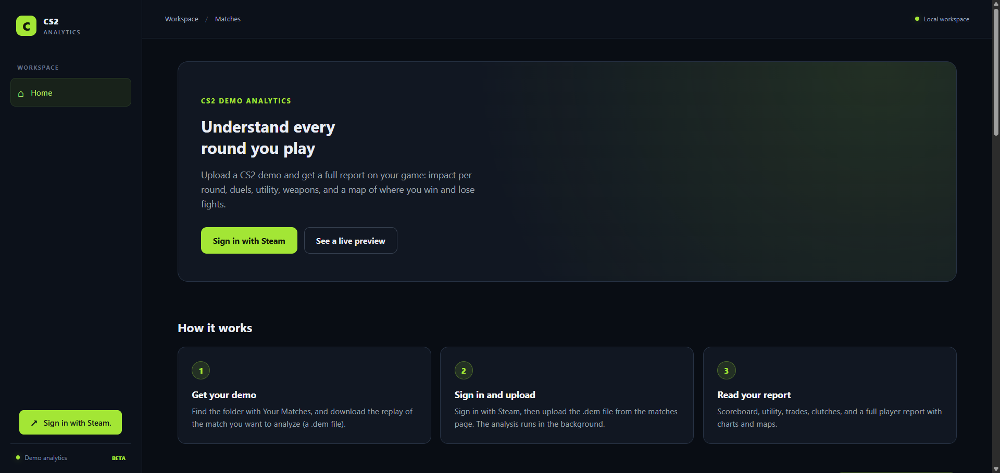 | 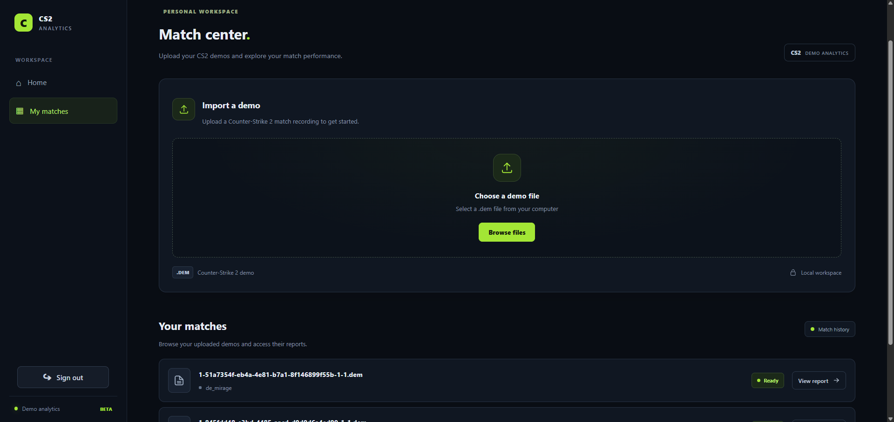 |

| Player report | Kill map |
|---|---|
| 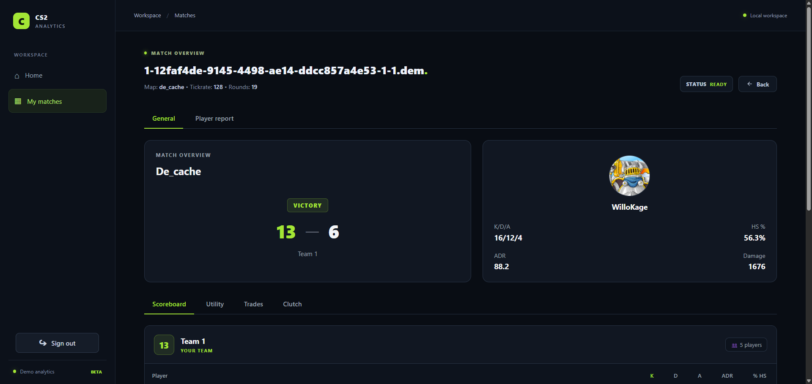 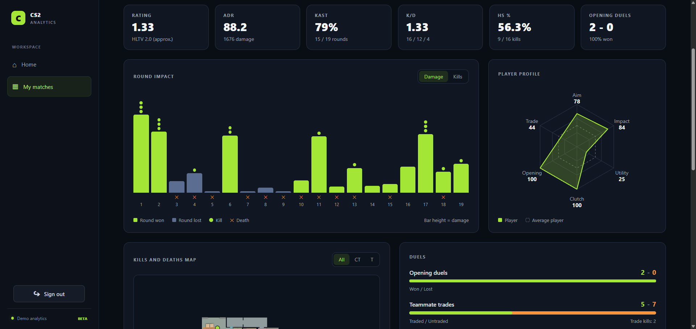 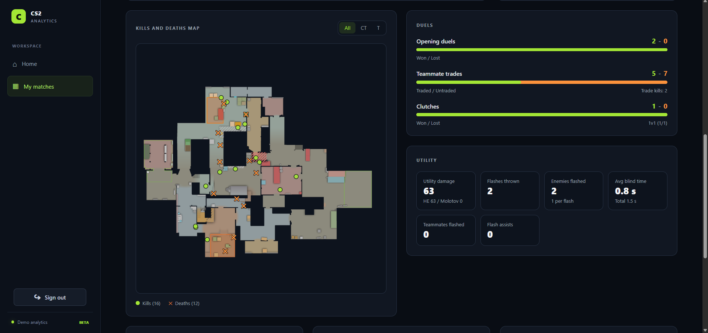 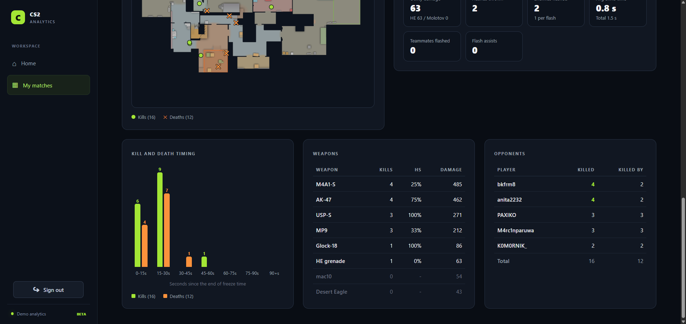 |  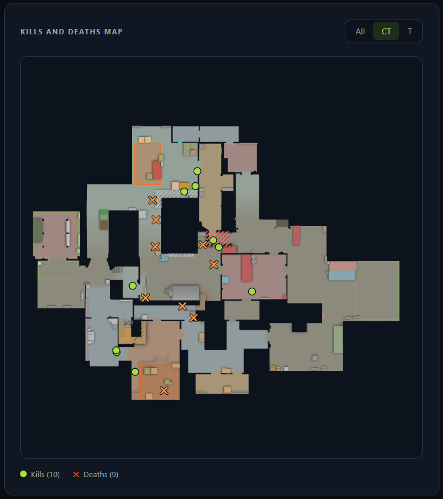 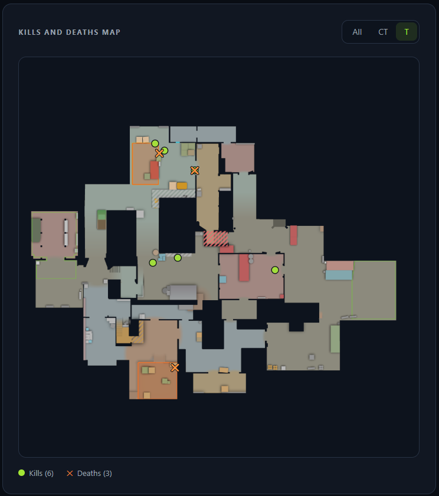 |

## Architecture

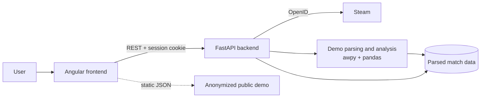

**Backend**
- FastAPI exposes the matches, the report endpoints and the Steam authentication.
- Demos are parsed with [awpy](https://github.com/pnxenopoulos/awpy), then analysed with dedicated modules (trades, KAST, rating, openings, utility, weapons, positions).
- Shared helpers and generic schemas keep the analysis code free of duplication.
- Ownership is enforced server side: a user can only read their own matches.

**Frontend**
- Angular with standalone components, **signals**, `input.required` and `httpResource`.
- A shared store keeps the match list in sync after an upload and polls the parsing status with an `effect`.
- Routing with `/matches` and `/matches/:id`, an auth interceptor and a route guard.
- Charts and the kill map are drawn with SVG.

## Tech stack

| Layer | Technologies |
|---|---|
| Frontend | Angular, TypeScript, signals, SVG, SCSS |
| Backend | Python 3.13, FastAPI, awpy, pandas |
| Auth | Steam OpenID, cookie session |
| Tooling | uv, pytest, Git, GitHub |
| Deployment (in progress) | Docker, Cloudflare, GitHub Actions |

## Getting started

### Prerequisites
- Python 3.13 and [uv](https://docs.astral.sh/uv/)
- Node.js 24 and npm
- A Steam Web API key (for sign-in)
- One or more `.dem` files

### Backend

```bash
cd backend
uv sync
cp .env.example .env        # fill in your Steam API key and session secret
uv run uvicorn app.main:app --reload
```

The API is then available at `http://localhost:8000` (interactive docs at `/docs`).

Run the tests:

```bash
uv run pytest
```

### Frontend

```bash
cd frontend
npm install
npm start
```

The app is served at `http://localhost:4200`.

### Rebuild the public demo (optional)

```bash
cd backend
uv run python scripts/anonymize_demo.py <path-to-demo.dem>
uv run python -m app.scripts.export_demo
```

The static JSON files are written to `frontend/public/demo`.

## API overview

| Endpoint | Description |
|---|---|
| `GET /health` | Health check |
| `GET /auth/me` | Current signed-in user |
| `GET /matches` | Matches of the current user |
| `GET /matches/{id}` | Match details and general stats |
| `GET /matches/{id}/report/summary` | Key figures, KAST, rating |
| `GET /matches/{id}/report/rounds` | Impact per round |
| `GET /matches/{id}/report/timing` | Timing of events in rounds |
| `GET /matches/{id}/report/opening` | Opening duels and trades |
| `GET /matches/{id}/report/extras` | Utility and extras |
| `GET /matches/{id}/report/weapons` | Per-weapon stats, victims and nemeses |
| `GET /matches/{id}/report/positions` | Kill and death coordinates on the radar |
| `GET /matches/{id}/report/profile` | Play profile for the radar chart |
| `GET /maps/{map}/radar` | Radar image of a map |

## Project structure

```
cs-demo-dashboard/
├── backend/
│   ├── app/
│   │   ├── analysis/      # trades, KAST, rating, openings, weapons...
│   │   ├── scripts/       # export_demo and other tools
│   │   └── ...            # routes, schemas, auth
│   ├── assets/maps/       # radar images and map data
│   └── tests/
├── frontend/
│   ├── public/demo/       # anonymized static demo data
│   └── src/app/           # components, services, store
└── scripts/
    └── anonymize_demo.py
```

## Design decisions

- **Trades use the real tickrate.** The tickrate is read from the demo (128 on FACEIT, 64 on matchmaking) and the trade window is 3 seconds, so results stay comparable across sources.
- **A trade must be made by another player than the victim.**
- **Kills with no identified victim are counted** in the stats table, so totals match the in-game numbers.
- **The public demo works without the backend.** Static JSON keeps the home page fast and cheap to host.
- **The rating is an approximation** of the HLTV 2.0 formula, built from public information.

## Roadmap

- [x] Demo parsing and per-player stats
- [x] Steam sign-in and per-user match ownership
- [x] Player report (summary, impact, profile, duels, utility, timing, weapons, kill map)
- [x] Anonymized public demo
- [ ] Home page with tutorial
- [ ] Player selector to analyse any player of the match
- [ ] CT / T side filter
- [ ] GIFs of key rounds
- [ ] Public deployment (Docker, Cloudflare, CI/CD with GitHub Actions)

## Acknowledgments

- [awpy](https://github.com/pnxenopoulos/awpy) for demo parsing and map data
- [HLTV](https://www.hltv.org/) for the public description of the rating 2.0 concept

## License

Distributed under the MIT License. See `LICENSE` for details.

---

<div align="center">

Built by **William**, software and AI engineer based in Lyon.

</div>